<p align="center">
  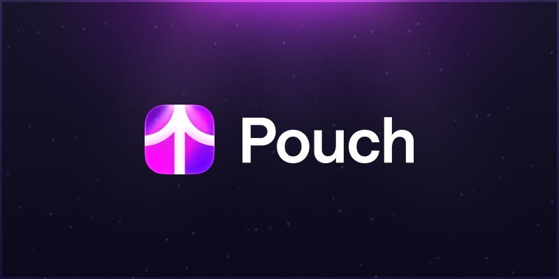
</p>

<p align="center">
  <b>Your whole crypto portfolio in one private, local dashboard.</b><br>
  Public addresses only · encrypted on disk · runs on <code>127.0.0.1</code>
</p>

<p align="center">
  <a href="https://github.com/gonnabeceo/pouch/actions/workflows/ci.yml"></a>
  <a href="LICENSE"></a>
  
  
  
</p>

<p align="center">
  <b>English</b> · <a href="README.ru.md">Русский</a>
</p>

---

Pouch is a self-hosted tracker that shows what your crypto is worth — in **USD and RUB** — across Bitcoin, EVM chains, Solana, TON, Tron, Hyperliquid and more. You paste public addresses; Pouch pulls balances, staking, DeFi positions and perps from public APIs, prices them with CoinGecko, and keeps everything in an encrypted database on your own machine.

No accounts, no cloud, no telemetry, and **never** a private key or seed phrase.

<p align="center">
  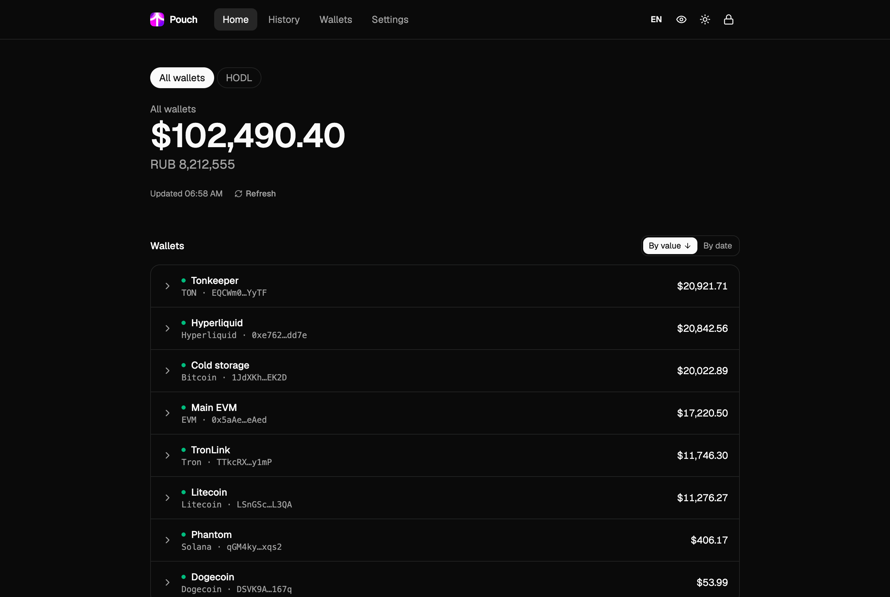
</p>

## Contents

- [Features](#features)
- [Screenshots](#screenshots)
- [Supported networks](#supported-networks)
- [Quick start](#quick-start)
- [API keys](#api-keys)
- [Security model](#security-model)
- [Development](#development)
- [Project structure](#project-structure)
- [Limitations](#limitations)
- [License](#license)

## Features

**Portfolio**
- One total in USD and RUB, with per-wallet and per-asset breakdowns and each asset's share of the portfolio.
- Wallets expand down to individual tokens, staking, and DeFi positions grouped by protocol (deposits, rewards, debt shown as negative).
- **Portfolios** — named sets of wallets with their own total (for example, "HODL" vs. "Trading"). A wallet can belong to several.
- Sort wallets by value or by date added; hide wallets without deleting them; keep notes per wallet.
- Spam tokens and dust (below a configurable threshold) are filtered out of the total but still counted, so nothing disappears silently.

**Hyperliquid, done properly**
- Add the master address — sub-accounts are discovered automatically.
- Spot, perps across all perp dexes (including HIP-3), vaults with unlock dates, and staked HYPE.
- Open positions with side, size, entry, PnL, leverage and liquidation price.
- Account mode aware (standard / unified / portfolio margin), and every account is reconciled against Hyperliquid's own total.

**History**
- Hourly snapshots of the total, taken automatically while Pouch is open.
- "Current holdings" mode: replays today's holdings against historical prices, so you get a 90-day chart from day one.
- Charts per portfolio and per asset, high/low/change tiles, ranges from 24h to all-time, and a table view for every chart.

**Comfort**
- English and Russian UI, switchable on the fly.
- Light and dark themes with a circular reveal animation (respects `prefers-reduced-motion`).
- **Streamer mode** (`Shift+H`): masks every amount, shortens addresses and hides notes — safe for screen sharing.
- Auto-refresh (every 5 minutes by default, configurable). If a provider fails, the last known value is shown and marked as stale.
- Responsive layout that works on a phone.

**Your data stays yours**
- Export snapshots and asset stats to CSV or JSON. Asset exports contain **no addresses or wallet names**, only coins, amounts and values.
- One-click encrypted backup (`.zip` with the encrypted database).

## Screenshots

| | |
|:---:|:---:|
| 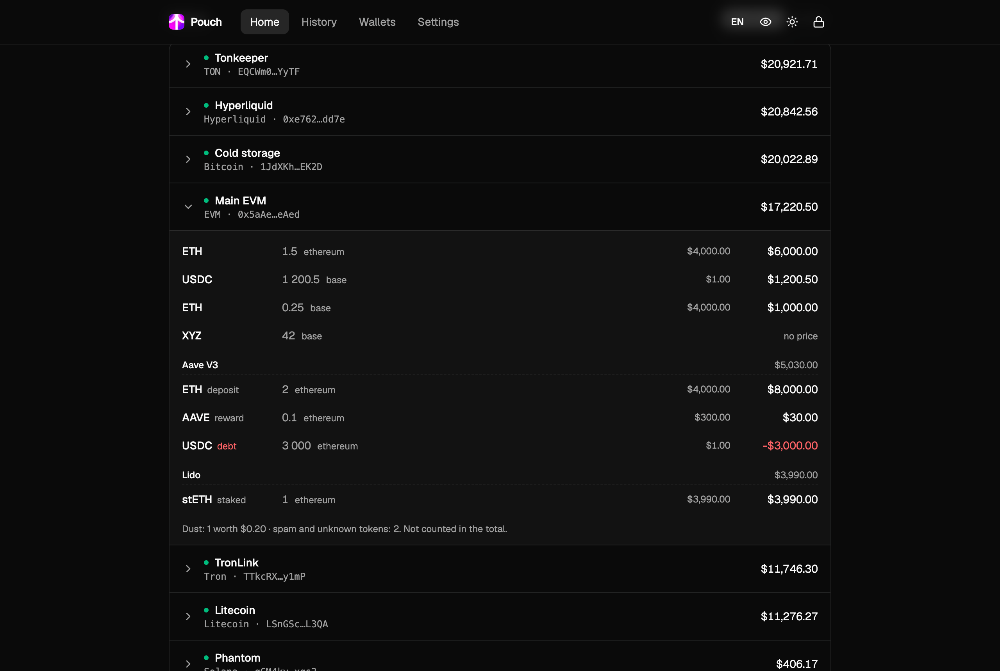<br><sub>EVM wallet with Aave and Lido positions</sub> | 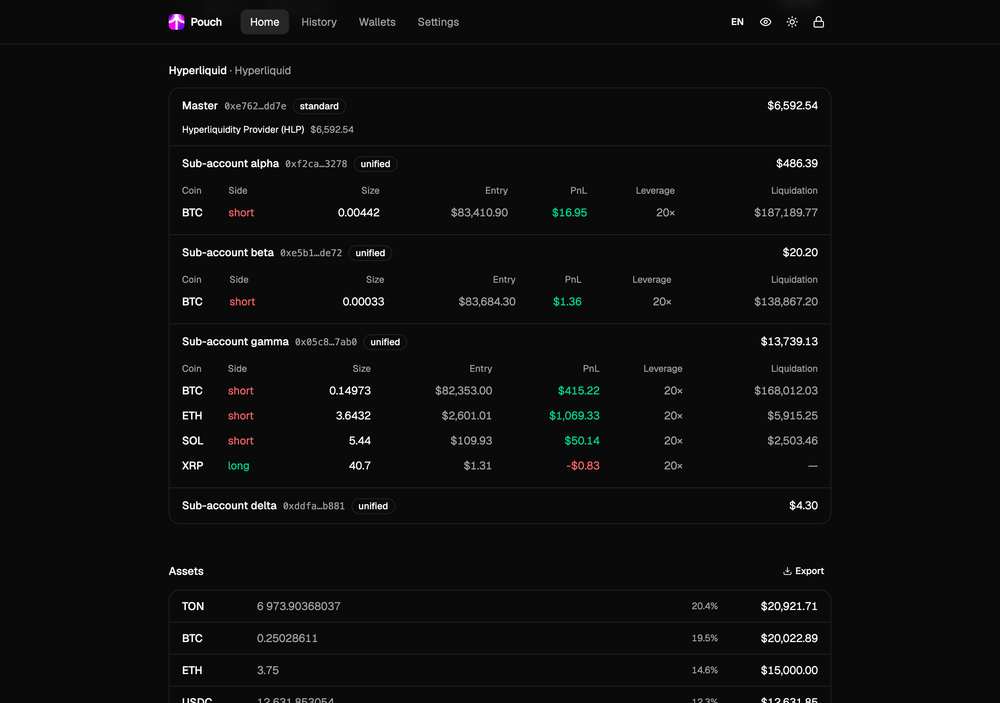<br><sub>Hyperliquid: sub-accounts, perps, vaults</sub> |
| 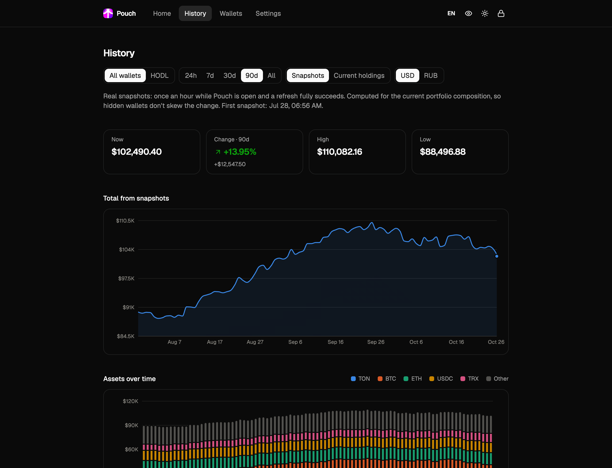<br><sub>History of the total</sub> | 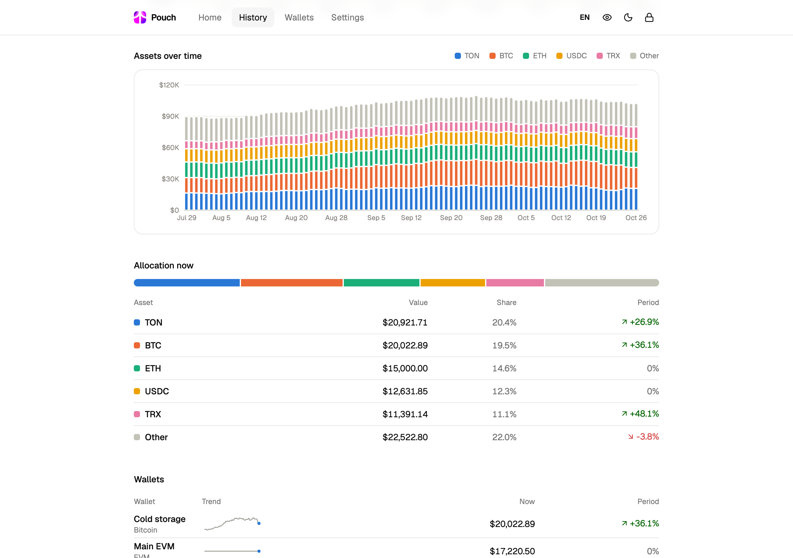<br><sub>History by asset</sub> |
| 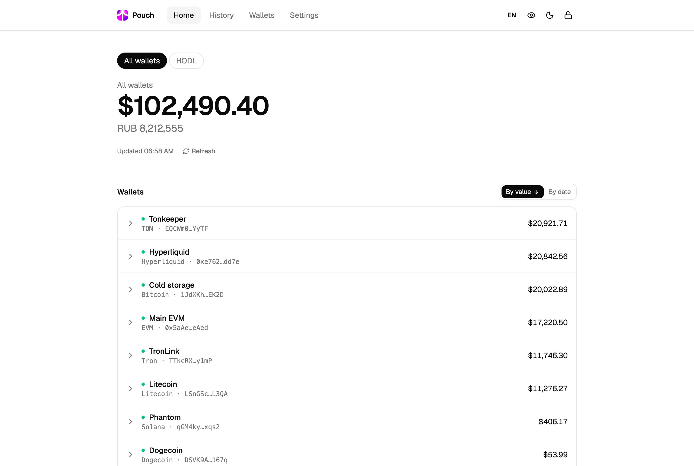<br><sub>Light theme</sub> | 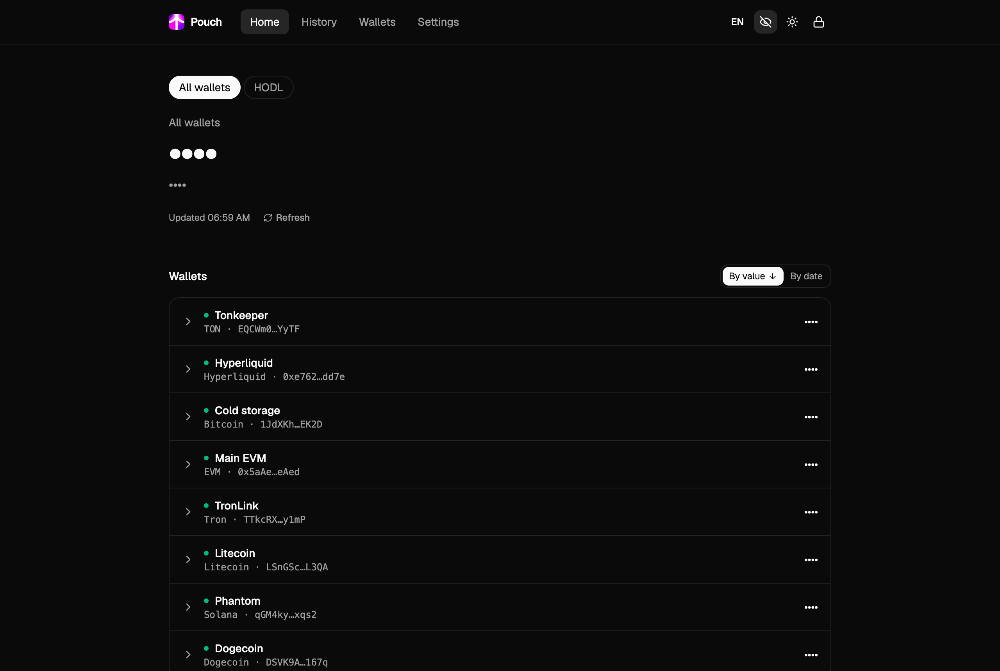<br><sub>Streamer mode</sub> |
| 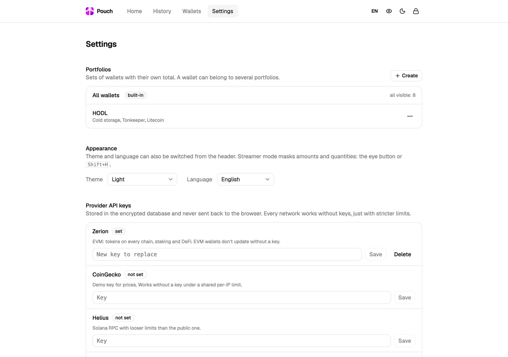<br><sub>Settings: portfolios, appearance, API keys</sub> | 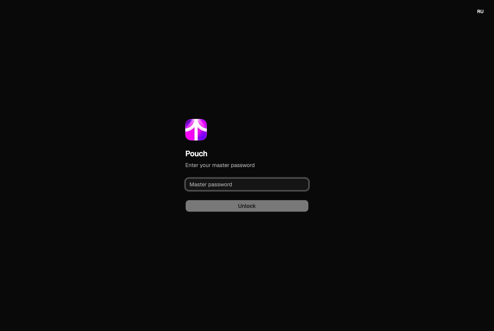<br><sub>Unlock with the master password</sub> |

<p align="center">
  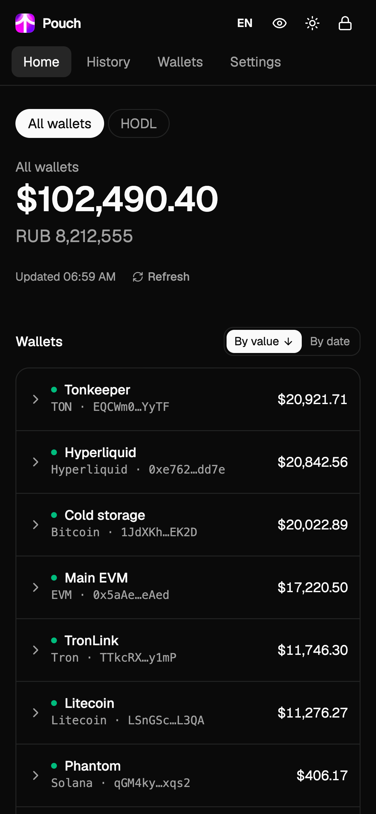
  &nbsp;&nbsp;
  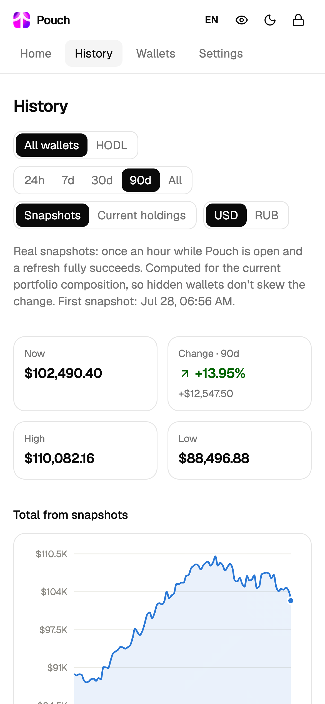
</p>

<sub>All screenshots use generated demo data — the addresses and balances are not real.</sub>

## Supported networks

| Network | Source | Key | What's counted |
|---|---|---|---|
| Bitcoin | [mempool.space](https://mempool.space) | — | Balance (legacy, SegWit, Taproot) |
| Litecoin | [litecoinspace.org](https://litecoinspace.org) | — | Balance |
| Dogecoin | [Dogechain](https://dogechain.com), BlockCypher as fallback | — | Balance |
| EVM chains | [Zerion](https://zerion.io/api) | **required** (free) | Tokens on every EVM chain incl. HyperEVM, staking, DeFi |
| Solana | Public RPC or [Helius](https://helius.dev) | optional | SOL, SPL tokens, stake accounts |
| TON | [TonAPI](https://tonapi.io) | optional | TON, jettons, nominator pools |
| Tron | [TronGrid](https://www.trongrid.io) | optional | TRX, TRC-20, Stake 2.0 |
| Hyperliquid | Public info API | — | Spot, perps, vaults, staked HYPE, sub-accounts |
| Prices | [CoinGecko](https://www.coingecko.com) | optional | USD prices, USD→RUB rate, historical prices |

Addresses are validated with checksums for each network before they are saved. Details on providers and their limits: [docs/providers.md](docs/providers.md), [docs/evm-aggregators.md](docs/evm-aggregators.md), [docs/hyperliquid.md](docs/hyperliquid.md) (in Russian).

## Quick start

**Requirements:** macOS or Linux, [uv](https://docs.astral.sh/uv/) and Node.js 22+.

```bash
git clone https://github.com/gonnabeceo/pouch.git
```

```bash
cd pouch && ./pouch.sh
```

The script builds the frontend on first run (and whenever the sources change), then starts the server. Open **http://127.0.0.1:8420**, choose a master password, and add your first wallet.

> [!IMPORTANT]
> The master password is the encryption key. **There is no recovery** — if you forget it, the data is gone. Make an encrypted backup from Settings once you have set things up.

**Start at login (macOS):**

```bash
scripts/install-launchd.sh
```

Logs go to `~/Library/Logs/pouch.log`. Remove with `scripts/install-launchd.sh --remove`.

**Environment variables:**

| Variable | Default | |
|---|---|---|
| `POUCH_DATA_DIR` | `./data` | Where the encrypted database lives |
| `POUCH_PORT` | `8420` | Port on `127.0.0.1` |
| `POUCH_LOG_LEVEL` | `INFO` | Log level |

## API keys

Every network works without keys except EVM. Keys are entered in **Settings**, stored inside the encrypted database, and never sent back to the browser.

| Provider | Needed for | Free tier |
|---|---|---|
| **Zerion** | EVM wallets (required) | Yes — [get a key](https://zerion.io/api) |
| CoinGecko | Higher price limits | Demo key |
| Helius | Faster, less limited Solana RPC | Yes |
| TonAPI | Higher TON limits | Yes |
| TronGrid | Higher Tron limits | Yes |

## Security model

Pouch is built for one person on one machine. In short:

- The whole database is encrypted with **SQLCipher 4**; the 256-bit key comes from your password via **Argon2id** (64 MiB, 3 passes). The password itself is never stored.
- The server listens only on `127.0.0.1` and checks `Host`/`Origin` against DNS rebinding and cross-site requests. The session cookie is `HttpOnly` and `SameSite=Strict`.
- Auto-lock after 15 minutes of inactivity; the key is wiped from SQLCipher on lock. Repeated wrong passwords trigger an increasing delay.
- A strict Content Security Policy: no CDNs, no external scripts or fonts, no telemetry.
- Logs contain no addresses or amounts. Exports require the master password.

Data providers do see the addresses you query and your IP — that is inherent to using public APIs. Full details and how to report a vulnerability: [SECURITY.md](SECURITY.md).

## Development

```bash
cd backend && uv run pytest
```

Backend tests run against recorded (and anonymized) API responses, so they need no network access.

Run the API and the Vite dev server with hot reload (http://127.0.0.1:5173):

```bash
POUCH_DEV=1 uv run --project backend python -m pouch
```

```bash
cd frontend && npm run dev
```

Frontend checks — the same ones CI runs:

```bash
cd frontend && npm run check:i18n && npm run lint && npm run build
```

**Translations.** UI strings are written in Russian and wrapped in `t("…")`; English lives in [`frontend/src/lib/i18n.en.ts`](frontend/src/lib/i18n.en.ts). `npm run check:i18n` fails if any string lacks an English translation.

**Stack:** Python 3.12+, FastAPI, httpx, SQLCipher, Argon2 · React 19, TypeScript, Vite, Tailwind CSS, shadcn/ui, Recharts.

## Project structure

```
pouch/
├── pouch.sh                 # one-command start
├── backend/
│   ├── pouch/
│   │   ├── main.py          # FastAPI app, security middleware, static files
│   │   ├── vault.py         # SQLCipher + Argon2id, lock/unlock, rekey
│   │   ├── chains/          # one adapter per network
│   │   ├── prices.py        # CoinGecko prices and coin directory
│   │   ├── portfolio.py     # refresh, totals, portfolios, dust and spam
│   │   ├── snapshots.py     # hourly snapshots, CSV/JSON, backups
│   │   ├── history.py       # simulated history from historical prices
│   │   └── api/             # HTTP routes
│   └── tests/               # pytest + recorded API fixtures
├── frontend/
│   └── src/
│       ├── pages/           # Home, History, Wallets, Settings, Login
│       ├── components/      # dialogs and shadcn/ui
│       └── lib/             # API client, i18n, formatting, theme
├── scripts/                 # launchd autostart
└── docs/                    # provider research, screenshots
```

## Limitations

- **DeFi outside EVM** isn't covered: free sources for Solana, TON and Tron don't expose DeFi positions. Liquid staking tokens are still counted as regular tokens.
- **Tokens unknown to CoinGecko** are treated as likely spam and excluded from the total (they are counted, not hidden silently).
- **Snapshot history** only exists for the time Pouch was running. The "current holdings" mode fills the gap, but it doesn't know about past trades.
- Built and tested on macOS. Linux should work; Windows is untested.

## License

[MIT](LICENSE). Price data provided by [CoinGecko](https://www.coingecko.com).

Pouch is not financial advice and is not affiliated with any of the data providers above.
