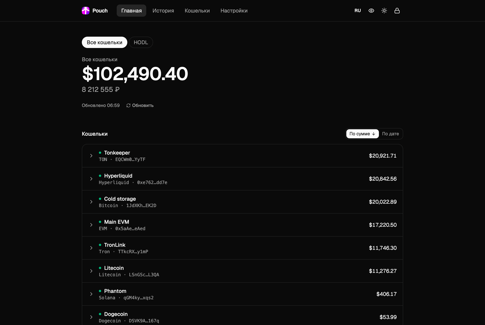
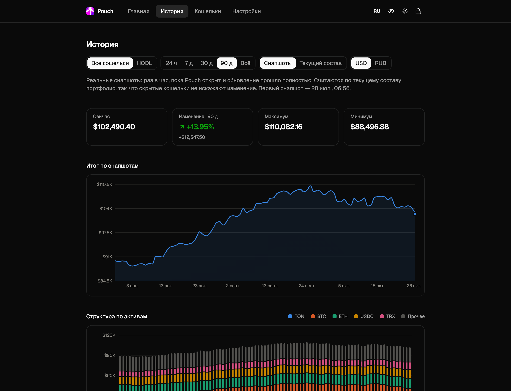

<p align="center">
  
</p>

<p align="center">
  <b>Весь криптопортфель на одном приватном локальном экране.</b><br>
  Только публичные адреса · шифрование на диске · работает на <code>127.0.0.1</code>
</p>

<p align="center">
  <a href="https://github.com/gonnabeceo/pouch/actions/workflows/ci.yml"></a>
  <a href="LICENSE"></a>
  
  
  
</p>

<p align="center">
  <a href="README.md">English</a> · <b>Русский</b>
</p>

---

Pouch — самостоятельно размещаемый трекер, который показывает, сколько стоит ваша крипта в **долларах и рублях**: Bitcoin, EVM-сети, Solana, TON, Tron, Hyperliquid и другие. Вы вставляете публичные адреса — Pouch забирает балансы, стейкинг, DeFi-позиции и перпы из публичных API, оценивает их по CoinGecko и хранит всё в зашифрованной базе на вашем компьютере.

Без аккаунтов, облака и телеметрии. И **никогда** не просит приватные ключи или сид-фразы.

<p align="center">
  
</p>

## Содержание

- [Возможности](#возможности)
- [Скриншоты](#скриншоты)
- [Поддерживаемые сети](#поддерживаемые-сети)
- [Быстрый старт](#быстрый-старт)
- [API-ключи](#api-ключи)
- [Модель безопасности](#модель-безопасности)
- [Разработка](#разработка)
- [Структура проекта](#структура-проекта)
- [Ограничения](#ограничения)
- [Лицензия](#лицензия)

## Возможности

**Портфель**
- Общий итог в USD и RUB, разбивка по кошелькам и по активам с долей каждого актива.
- Кошелёк раскрывается до токенов, стейкинга и DeFi-позиций по протоколам: депозиты, награды, долги со знаком минус.
- **Портфолио** — именованные наборы кошельков со своим итогом, например «HODL» и «Трейдинг». Кошелёк может входить в несколько.
- Сортировка кошельков по сумме или по дате добавления, скрытие без удаления, заметки к кошелькам.
- Спам-токены и пыль ниже заданного порога не входят в итог, но учитываются счётчиком — ничего не пропадает молча.

**Hyperliquid как следует**
- Достаточно мастер-адреса — суб-аккаунты подтягиваются сами.
- Спот, перпы на всех перп-биржах (включая HIP-3), vaults с датой разблокировки, застейканный HYPE.
- Открытые позиции: сторона, размер, вход, PnL, плечо, цена ликвидации.
- Учитывается режим аккаунта (standard / unified / portfolio margin), сумма каждого аккаунта сверяется с итогом самого Hyperliquid.

**История**
- Снапшоты итога раз в час, пока Pouch открыт.
- Режим «Текущий состав»: нынешние активы по историческим ценам — график за 90 дней с первого же дня.
- Графики по портфолио и по активам, плитки «максимум / минимум / изменение», периоды от 24 часов до всего времени, таблица для каждого графика.

**Удобство**
- Интерфейс на русском и английском, переключается на лету.
- Светлая и тёмная тема с анимацией раскрытия кругом (с учётом `prefers-reduced-motion`).
- **Режим стримера** (`Shift+H`): маскирует все суммы, сокращает адреса и прячет заметки — можно спокойно показывать экран.
- Автообновление (по умолчанию раз в 5 минут, настраивается). Если источник недоступен, показывается последнее значение с пометкой «устарело».
- Адаптивная вёрстка — работает и на телефоне.

**Ваши данные — ваши**
- Экспорт снапшотов и статистики по активам в CSV или JSON. В экспорте активов **нет адресов и названий кошельков** — только монеты, количества и суммы.
- Зашифрованный бэкап одной кнопкой (`.zip` с зашифрованной базой).

## Скриншоты

| | |
|:---:|:---:|
| <br><sub>EVM-кошелёк с позициями в Aave и Lido</sub> | <br><sub>Hyperliquid: суб-аккаунты, перпы, vaults</sub> |
| <br><sub>История итога</sub> | <br><sub>История по активам</sub> |
| <br><sub>Светлая тема</sub> | <br><sub>Режим стримера</sub> |
| <br><sub>Настройки: портфолио, оформление, ключи</sub> | <br><sub>Вход по мастер-паролю</sub> |

<p align="center">
  
  &nbsp;&nbsp;
  
</p>

<sub>На скриншотах демо-данные: адреса и балансы ненастоящие.</sub>

## Поддерживаемые сети

| Сеть | Источник | Ключ | Что учитывается |
|---|---|---|---|
| Bitcoin | [mempool.space](https://mempool.space) | — | Баланс (legacy, SegWit, Taproot) |
| Litecoin | [litecoinspace.org](https://litecoinspace.org) | — | Баланс |
| Dogecoin | [Dogechain](https://dogechain.com), запасной — BlockCypher | — | Баланс |
| EVM-сети | [Zerion](https://zerion.io/api) | **нужен** (бесплатный) | Токены во всех EVM-сетях, включая HyperEVM, стейкинг, DeFi |
| Solana | Публичный RPC или [Helius](https://helius.dev) | по желанию | SOL, SPL-токены, стейк-аккаунты |
| TON | [TonAPI](https://tonapi.io) | по желанию | TON, жетоны, номинатор-пулы |
| Tron | [TronGrid](https://www.trongrid.io) | по желанию | TRX, TRC-20, Stake 2.0 |
| Hyperliquid | Публичный info API | — | Спот, перпы, vaults, стейк HYPE, суб-аккаунты |
| Цены | [CoinGecko](https://www.coingecko.com) | по желанию | Цены в USD, курс USD→RUB, исторические цены |

Перед сохранением адрес проверяется по формату и контрольной сумме своей сети. Подробно о провайдерах и лимитах: [docs/providers.md](docs/providers.md), [docs/evm-aggregators.md](docs/evm-aggregators.md), [docs/hyperliquid.md](docs/hyperliquid.md).

## Быстрый старт

**Нужно:** macOS или Linux, [uv](https://docs.astral.sh/uv/) и Node.js 22+.

```bash
git clone https://github.com/gonnabeceo/pouch.git
```

```bash
cd pouch && ./pouch.sh
```

При первом запуске (и после изменений в исходниках) скрипт соберёт фронт, затем поднимет сервер. Откройте **http://127.0.0.1:8420**, задайте мастер-пароль и добавьте первый кошелёк.

> [!IMPORTANT]
> Мастер-пароль — это ключ шифрования. **Восстановить его нельзя**: забытый пароль = потерянные данные. Сделайте зашифрованный бэкап в настройках, когда всё настроите.

**Автозапуск при входе в macOS:**

```bash
scripts/install-launchd.sh
```

Лог — `~/Library/Logs/pouch.log`. Удалить: `scripts/install-launchd.sh --remove`.

**Переменные окружения:**

| Переменная | По умолчанию | |
|---|---|---|
| `POUCH_DATA_DIR` | `./data` | Где лежит зашифрованная база |
| `POUCH_PORT` | `8420` | Порт на `127.0.0.1` |
| `POUCH_LOG_LEVEL` | `INFO` | Уровень логов |

## API-ключи

Все сети, кроме EVM, работают без ключей. Ключи вводятся в **настройках**, хранятся в зашифрованной базе и никогда не возвращаются в браузер.

| Провайдер | Зачем | Бесплатно |
|---|---|---|
| **Zerion** | EVM-кошельки (обязательно) | Да — [получить ключ](https://zerion.io/api) |
| CoinGecko | Более щедрые лимиты цен | Demo-ключ |
| Helius | Быстрый Solana RPC с меньшими ограничениями | Да |
| TonAPI | Лимиты повыше для TON | Да |
| TronGrid | Лимиты повыше для Tron | Да |

## Модель безопасности

Pouch рассчитан на одного человека на одном компьютере. Коротко:

- База целиком шифруется **SQLCipher 4**; 256-битный ключ выводится из пароля через **Argon2id** (64 МиБ, 3 прохода). Сам пароль нигде не хранится.
- Сервер слушает только `127.0.0.1` и проверяет `Host`/`Origin` против DNS rebinding и запросов с чужих страниц. Cookie сессии — `HttpOnly` и `SameSite=Strict`.
- Автоблокировка через 15 минут бездействия, при блокировке SQLCipher стирает ключ. После неверных паролей включается растущая пауза.
- Строгая Content Security Policy: никаких CDN, внешних скриптов, шрифтов и телеметрии.
- В логах нет адресов и сумм. Экспорт требует мастер-пароль.

Провайдеры данных видят адреса, которые вы запрашиваете, и ваш IP — без этого публичными API не воспользоваться. Подробности и как сообщить об уязвимости: [SECURITY.md](SECURITY.md).

## Разработка

```bash
cd backend && uv run pytest
```

Тесты бэкенда идут на записанных (и обезличенных) ответах API, сеть им не нужна.

API и dev-сервер Vite с hot reload (http://127.0.0.1:5173):

```bash
POUCH_DEV=1 uv run --project backend python -m pouch
```

```bash
cd frontend && npm run dev
```

Проверки фронта — те же, что в CI:

```bash
cd frontend && npm run check:i18n && npm run lint && npm run build
```

**Переводы.** Строки интерфейса пишутся по-русски и оборачиваются в `t("…")`, английские — в [`frontend/src/lib/i18n.en.ts`](frontend/src/lib/i18n.en.ts). `npm run check:i18n` падает, если у строки нет перевода.

**Стек:** Python 3.12+, FastAPI, httpx, SQLCipher, Argon2 · React 19, TypeScript, Vite, Tailwind CSS, shadcn/ui, Recharts.

## Структура проекта

```
pouch/
├── pouch.sh                 # запуск одной командой
├── backend/
│   ├── pouch/
│   │   ├── main.py          # FastAPI, защитные middleware, статика
│   │   ├── vault.py         # SQLCipher + Argon2id, блокировка, смена пароля
│   │   ├── chains/          # по адаптеру на сеть
│   │   ├── prices.py        # цены и справочник монет CoinGecko
│   │   ├── portfolio.py     # обновление, итоги, портфолио, пыль и спам
│   │   ├── snapshots.py     # снапшоты, CSV/JSON, бэкапы
│   │   ├── history.py       # история по историческим ценам
│   │   └── api/             # HTTP-роуты
│   └── tests/               # pytest и записанные ответы API
├── frontend/
│   └── src/
│       ├── pages/           # Главная, История, Кошельки, Настройки, Вход
│       ├── components/      # диалоги и shadcn/ui
│       └── lib/             # API-клиент, i18n, форматирование, тема
├── scripts/                 # автозапуск через launchd
└── docs/                    # разбор провайдеров, скриншоты
```

## Ограничения

- **DeFi вне EVM** не поддерживается: бесплатные источники для Solana, TON и Tron не отдают DeFi-позиции. Токены ликвидного стейкинга при этом учитываются как обычные.
- **Токены, которых нет в CoinGecko**, считаются вероятным спамом и не входят в итог (их видно в счётчике).
- **История по снапшотам** есть только за время, пока Pouch был запущен. Режим «Текущий состав» закрывает пробел, но не знает о прошлых сделках.
- Сделано и проверено на macOS. На Linux должно работать, Windows не проверялся.

## Лицензия

[MIT](LICENSE). Данные о ценах — [CoinGecko](https://www.coingecko.com).

Pouch не является финансовой рекомендацией и не связан ни с одним из провайдеров данных.
